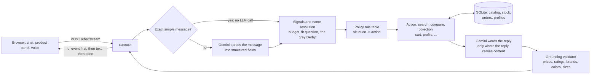

# Shopper

A conversational shopping agent that talks like a helpful salesperson, drives a product panel from the chat, gives honest
opinions grounded in real catalog data, handles objections, respects a "no", and takes you through a (mock) checkout.
Shoes, clothes and accessories; text or voice. FastAPI backend, Next.js + Tailwind frontend.

It is a portfolio project about one question: **how do you make an LLM sales assistant that is fast, grounded and
trustworthy, and how do you measure that?** The answer here is a deterministic decision layer around the model, a
validator that checks every number the model says against the database, and an evaluation harness.

> Status: phases 0-8 of the plan are built. 251 backend tests (fake LLM) and 29 frontend tests pass. Four real evaluation runs on Gemini
> (16 simulated shoppers per system) have shaped the design. The newest features (streaming, voice, apparel/accessories,
> Docker) are covered by tests but have not yet been exercised end to end in a real browser or against live Gemini by the
> author of this repo. See [Honest limitations](#honest-limitations).

## Quick start

Python 3.11+, Node 20.9+ (22 recommended) and a Gemini API key ([Google AI Studio](https://aistudio.google.com/)).

```bash
# 1. backend
python -m venv .venv
source .venv/bin/activate            # Windows PowerShell: .venv\Scripts\Activate.ps1
pip install -r requirements-dev.txt
pytest -q                            # no key needed: tests use a fake LLM
python -m data.seed                  # builds data/shop.db (300 shoes, 90 apparel, 60 accessories; synthetic)
export GEMINI_API_KEY=...            # PowerShell: $env:GEMINI_API_KEY="..."
uvicorn app.main:app --reload        # API on http://localhost:8000

# 2. frontend (a second terminal)
cd web
npm install
npm run dev                          # open http://localhost:3000  (it proxies /api/* to the backend)
```

No key yet? `python -m scripts.serve_fake` starts the backend with a keyword-matching fake LLM (not Gemini) so you can try
the whole UI. Backend only, no Node: `uvicorn` also serves a plain-JavaScript fallback UI at http://localhost:8000
(`frontend/`, kept as a lightweight option).

Try: `sports shoes, size 9` -> click a shoe -> `what do you think of it?` -> `too expensive` -> `buy this` -> `place order`.
A two-minute script that shows everything is in [docs/DEMO.md](docs/DEMO.md).

## How it works



**Core rule: Python decides what to do next; the LLM understands and words.** The model turns a message into fields
(intent, use, size, budget...). A first-match-wins rule table (`app/policy/rules.py`, 20+ rules, each reply reports which one
fired) picks the action. Anything involving money (cart, order confirmation) is fixed text built from database values.
Replies the model words (opinions, comparisons, objection answers) pass through `app/validators.py`: a sentence that states a
price, rating, brand, color or size the database does not support is regenerated once, then stripped, then replaced by a
reply built straight from the data. Details: [docs/ARCHITECTURE.md](docs/ARCHITECTURE.md).

## What it does

| Area | Behavior |
|---|---|
| Conversation | One question at a time; several answers in one message are accepted; saved size is reused; a gift's size never overwrites yours |
| Opinions | Honest, data-only: who it suits, a strength, a trade-off, and "I don't have that" for fit or durability it cannot know |
| Salesperson skills | Price / fit / quality objections, side-by-side compare, relaxed browsing, "cheaper / other colors / show more" |
| Stop-selling | An explicit "no thanks" always wins; after it, small talk gets a quiet reply with no question and no products |
| Names and prices | "the grey Hush Puppies Derby" or "that 1,999 one" are understood; ambiguous names are asked about, never guessed |
| Profile | Size, budget, style, liked or avoided colors, undertone; every fact says where it came from; "what do you know about me" / "forget my profile" |
| Complexion | Opt-in photo, one photo per consent, estimate shown for you to confirm or correct, photo never stored, only the confirmed result saved |
| Categories | Shoes, apparel (XS-XXL) and accessories (one size) on the same engine |
| Speed | Thinking tuned for simple calls, a no-LLM fast path for exact messages, fixed text for plain questions, optional smaller model, products appear before the sentence |
| Voice | Browser speech input (Mic) and spoken replies (toggle), where the browser supports them |
| Frontend | Next.js (App Router) + Tailwind: streamed replies, product grid / detail / compare, cart and profile drawers, photo flow, dark mode |

## Configuration

| Variable | Default | Meaning |
|---|---|---|
| `GEMINI_API_KEY` | - | Required for the app (not for the tests) |
| `GEMINI_MODEL` | `gemini-2.5-flash` | Model for opinions, comparisons, objections. Set to a model your key can use |
| `GEMINI_FAST_MODEL` | same | Optional smaller model for parsing and short wording |
| `GEMINI_THINKING` | `low` | `minimal` / `low` / `medium` / `high`, a token budget for 2.5 models, or `default` |
| `FASTPATH` | `1` | Skip the LLM for exact simple messages |
| `PHRASE_ALL` | `0` | `1` has the LLM word every reply, including plain questions (slower) |
| `RATE_LIMIT_PER_MIN` | `60` | Per client; `0` disables |
| `MAX_SESSIONS` | `5000` | Conversations kept in memory |
| `AUTO_SEED` / `TRUST_PROXY` | off | Build the catalog on first start / read the client from `X-Forwarded-For` |

## API

`POST /chat` and `POST /chat/stream` (server-sent events: `status`, `ui`, `text`, `done`), `GET /products`, `GET /products/{id}`,
`GET/POST /cart...`, `POST /checkout`, `GET /orders/{id}`, `GET /profile`, `POST /profile/forget`,
`POST /complexion/{consent,analyze,confirm,cancel}`, `GET /health`, `GET /ready`. The chat response is
`{reply, slots, ui_action, policy}`; `ui_action` is one of `show_products`, `focus_product`, `compare`, `add_to_cart`,
`checkout`, `request_photo`, `none`.

## Evaluation

`python -m eval.run` compares three systems on simulated shoppers across eight scenario types (vague, strong preference, price
objection, indecision, rejection, off-topic, sizing/stock, frustration): a plain prompt, retrieval + memory, and this agent.
Latest run (seed 23, 16 shoppers per system, `gemini-3.5-flash-lite`):

| | plain | rag | agent |
|---|---|---|---|
| Task completion (95% CI) | 88% [64-97] | 88% [64-97] | 94% [72-99] |
| Turns to decision | 9.8 | 4.4 | 4.0 |
| Shown items that fit the shopper | n/a | 83% | 100% |
| Replies with an invented price | 12% | 0% | 0% |
| Latency per reply | 1.35 s | 1.98 s | 1.27 s |

Completion is statistically a tie at this sample size. What the agent shows is grounding, speed and fewer turns; where it
trailed (respecting a "no") was found, fixed and re-tested. Methodology, the full table, the draft analysis and the
list of caveats are in [docs/EVALUATION.md](docs/EVALUATION.md); how each bug was found is in
[docs/DEVELOPMENT_LOG.md](docs/DEVELOPMENT_LOG.md).

## Honest limitations

- The catalog is **synthetic** (generated, with colored placeholders instead of images). Real inventory is messier.
- Evaluation uses **simulated shoppers and an LLM judge** from one model family. Samples so far are n=16 per system; the
  harness supports 150-300. Nothing here has been checked against real customers; a 30-conversation human-review step exists
  but has not been done yet.
- Evaluation personas cover **shoes only**; apparel and accessories are tested with unit tests, not simulated shoppers.
- Replies are validated **before** they are shown, so text is not streamed token by token from the model. The speed-up is that
  the product panel updates before the sentence is finished.
- The validator checks numbers and names, not free-form claims ("waterproof"). Prompts tell the model to say when the data
  does not cover something, but this is a mitigation, not a guarantee.
- Fixed-text replies for plain questions trade a little warmth for speed (`PHRASE_ALL=1` restores LLM wording).
- The palette that maps undertone to colors is a styling heuristic written for this project, not established fact.
- Voice depends on the browser: speech recognition is unavailable in some browsers, and in Chrome the audio is processed by
  the browser vendor's service.
- Conversations live in **memory**: a restart ends them and only one instance can run. Orders and saved profiles persist in SQLite.
- There is no login: a profile is tied to a random id kept in the browser. Checkout is a mock; nothing is charged.
- The Docker images and the GitHub Actions workflow were written but not built or run by the author. The Next.js app was built, type-checked and
  tested, and smoke-tested against the backend through its proxy with the fake LLM, but not driven in a real browser.

## Deploying

```bash
cp .env.example .env     # set GEMINI_API_KEY
docker compose up --build   # api (FastAPI) + web (Next.js); open http://localhost:3000
```
The API image builds the catalog on first start (`AUTO_SEED=1`) and listens on `$PORT`; the web image reads `BACKEND_URL` at
runtime and proxies `/api/*`, including the event stream, to it. Run **one instance** (in-memory sessions;
on Cloud Run set max instances to 1). Behind a load balancer set `TRUST_PROXY=1` so rate limiting sees real clients, and disable
proxy buffering for `/chat/stream` (`X-Accel-Buffering: no` is already sent). Put a spend cap on the API key: the rate limiter
is a safeguard, not a budget. `GET /ready` reports whether the catalog and key are present.

## Repository layout

```
web/        Next.js app: app/ (page, /api proxy route), components/, hooks/ (useShopper, useSpeech), lib/ (api, stream, format, types)
app/        main.py (API, SSE), schemas.py
  engine/   engine.py (turn handling), sales.py (objections, compare, browse), profile_flow.py, cart.py,
            resolve.py (names -> positions), signals.py (deterministic backstops), common.py, state.py
  llm/      client.py (Gemini), fastpath.py, prompts.py, schemas.py
  policy/   rules.py (the rule table)
  profile/  model.py, store.py, ranking.py (palette + preferences -> ranking)
  catalog/  db.py, search.py          validators.py (grounding checks)
data/       seed.py                   frontend/  plain-JS fallback UI     scripts/  serve_fake.py (key-less demo)
eval/       personas, simulators, systems, metrics, report, run, review, show, latency
tests/      251 backend tests         docs/      ARCHITECTURE, DEMO, EVALUATION, DEVELOPMENT_LOG, ROADMAP
```

## Development

```bash
ruff check . && pytest -q            # backend (also runs the plain-JS helper tests when Node is installed)
(cd web && npm run typecheck && npm test && npm run build)     # frontend
python -m eval.run --offline --systems agent --sim scripted --n 48    # harness check, free, not a result
python -m eval.latency               # where the time goes (needs a key)
```
