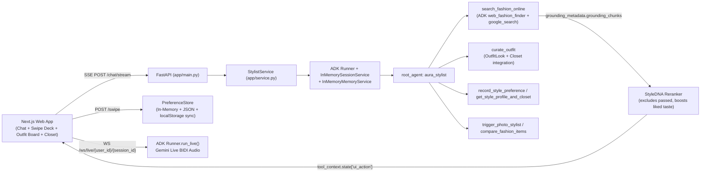

# Architecture

## Overview
Shopper ("Aura") is built on the **Google Agent Development Kit (`google-adk`)** with **zero database**. Instead of querying a static SQLite catalog, Aura discovers real buyable items online using **Google Search grounding**, builds head-to-toe **Outfit Lookbooks**, learns user taste from **Tinder/Instagram-style swipes**, and supports real-time **Gemini Live bidirectional voice**.

## Google ADK Package (`stylist_agent/`)
`stylist_agent/agent.py` exposes `root_agent` (`aura_stylist`), so the exact same agent works with:
- FastAPI (`app/main.py` -> `StylistService`)
- `adk web` / `adk run` (ADK CLI)
- `adk eval` / `AgentEvaluator` (`eval/adk_eval/stylist.evalset.json`)

### How Online Search & Grounded Swipe Cards Work
1. `root_agent` calls `search_fashion_online(query, category, max_budget_inr)`.
2. `LiveGoogleSearchBackend` runs an isolated ADK sub-agent (`web_fashion_finder`) equipped with `google_search` (keeping `google_search` cleanly separated from custom `FunctionTool`s).
3. We collect every `grounding_chunk.web.uri` and `title` from `event.grounding_metadata`.
4. A structured extraction pass (`_CardBatch` JSON schema) structures 4–6 `FashionItem` cards and ONLY attaches a direct product URL if it exists verbatim in `grounding_links` (`url_verified=true`); otherwise it generates a safe Google Shopping search link (`url_verified=false`) so links are never hallucinated.
5. `rerank_items(items, dna)` filters out any items the user previously swiped left on (`disliked_item_keys`) and scores remaining items using their **Style DNA** (liked aesthetics, liked/avoided colors, seasonal undertone palette, liked brands, and budget).
6. The ranked deck is written to `tool_context.state["ui_action"]` (`type="swipe_deck"`), which `StylistService.stream_chat()` emits immediately over SSE (`event: ui`) before the conversational reply finishes streaming.

## Zero-DB Taste Memory (`stylist_agent/memory.py`)
- **Style DNA** stores: sizes (`shoes`, `tops`, `bottoms`), weighted aesthetic affinities (`minimalist`, `quiet luxury`, `streetwear`, etc.), liked/disliked colors, liked brands, budget ceiling, skin tone/undertone/color season, `saved_closet`, `saved_outfits`, `disliked_item_keys`, `swipe_history`, and transparent `facts` provenance (`stated`, `confirmed`, `swiped`, `inferred`).
- **Free-tier persistence without a database**: `PreferenceStore` caches profiles in memory + lightweight JSON files (`data/profiles/*.json`), AND the Next.js frontend caches `StyleDNA` in `localStorage` and syncs on mount (`POST /profile/sync`) and chat turns so cold restarts on free container hosts never lose user taste.

## Dual Voice Architecture
1. **Primary — Gemini Live API (`WS /ws/live/{user_id}/{session_id}`)**: Uses ADK `Runner.run_live()` with `RunConfig(streaming_mode=StreamingMode.BIDI, response_modalities=["AUDIO"], output_audio_transcription=..., input_audio_transcription=...)` and `LiveRequestQueue`. Browser Web Audio captures 16kHz PCM16 audio and plays 24kHz PCM16 chunks with barge-in cancellation (`interrupted`).
2. **Fallback — Browser Web Speech API (`web/hooks/useSpeech.ts`)**: Continuous SpeechRecognition + SpeechSynthesis for environments without Live WebSocket audio.

## Privacy (Photo Studio)
Both **Seasonal Color Analysis** (`/complexion/*`) and **Outfit Check** (`/outfit-check/analyze`) require explicit per-upload consent (`/complexion/consent`). Image bytes are decoded strictly inside the request handler, passed to Gemini Vision, and deleted immediately (`del data`); photos are never written to disk or stored in ADK session state.
